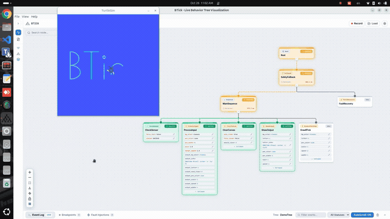

# BTick

BTick integrates with ROS 2 to provide real-time Behavior Tree monitoring and interactive debugging for [BehaviorTree.CPP v4](https://github.com/BehaviorTree/BehaviorTree.CPP) applications.

## Overview & Capabilities

The integration connects BTick to the BehaviorTree.CPP execution and monitoring interfaces to expose tree structure, runtime state transitions, and supported debugging controls.



## Prerequisites & Dependencies

Ensure ROS 2 and the required BehaviorTree.CPP dependencies are installed and available in your environment.

## Building the `btick` Package

Clone the repository into a ROS 2 workspace:

```bash
mkdir -p ~/robot_ws/src
cd ~/robot_ws/src
git clone https://github.com/SherifFathey/btick.git
```

Install dependencies and build the package:

```bash
cd ~/robot_ws
rosdep install --from-paths src --ignore-src -r -y
colcon build --packages-select btick --symlink-install
source install/setup.bash
```

## Package Configuration

### `CMakeLists.txt`

Add `btick` to your project's dependencies:

```cmake
cmake_minimum_required(VERSION 3.8)
project(my_robot_behavior)

find_package(ament_cmake REQUIRED)
find_package(rclcpp REQUIRED)
find_package(behaviortree_cpp REQUIRED)
find_package(btick REQUIRED)

add_executable(my_bt_runner src/my_bt_runner.cpp)

ament_target_dependencies(my_bt_runner
  rclcpp
  behaviortree_cpp
  btick
)

install(TARGETS my_bt_runner
  DESTINATION lib/${PROJECT_NAME}
)
```

### `package.xml`

Declare the dependencies in `package.xml`:

```xml
<depend>rclcpp</depend>
<depend>behaviortree_cpp</depend>
<depend>btick</depend>
```

## C++ Integration Example

The following steps show how to integrate BTick into an existing BehaviorTree.CPP application.

### Step 1: Include the BTick Header

```cpp
#include <btick/btick.hpp>
```

### Step 2: Attach the BTick Monitor

After creating your behavior tree, instantiate `btick::Monitor` to enable monitoring and supported debugging features in BTick:

```cpp
btick::Monitor monitor(node, tree, "MainRobotTree", xml_path);
```

Constructor arguments:

- `node`: The ROS 2 node used for communication.
- `tree`: The `BT::Tree` instance to monitor.
- `"MainRobotTree"`: The tree name displayed in the BTick interface.
- `xml_path`: The XML file path, used to retrieve tree definition details such as port metadata.

### Step 3: Enable Optional Logging

To record execution data to a JSON file, optionally create a `btick::Logs` instance:

```cpp
btick::Logs logs(monitor, "/tmp/mission_log.json", true);
```

Constructor arguments:

- `monitor`: The BTick monitor instance associated with the behavior tree.
- `"/tmp/mission_log.json"`: The base path for the JSON log file.
- `true`: Enables timestamp-based filenames, creating a new log file for each recording session.
- `false`: Reuses the same filename for each session instead of generating a timestamp-based filename.

Logging is optional and can be omitted if execution recording is not required.

### Step 4: Complete Integration Example

This example assumes the required BehaviorTree.CPP node types have been registered and the XML file is available.

```cpp
#include <string>

#include <rclcpp/rclcpp.hpp>
#include <behaviortree_cpp/bt_factory.h>
#include <btick/btick.hpp>

int main(int argc, char** argv)
{
  rclcpp::init(argc, argv);
  auto node = rclcpp::Node::make_shared("my_robot_bt_runner");

  {
    // Register the required BehaviorTree.CPP node types.
    BT::BehaviorTreeFactory factory;
    // factory.registerNodeType<MyActionNode>("MyAction");

    // Create the behavior tree from its XML definition.
    const std::string xml_path = "/path/to/my_behavior_tree.xml";
    auto tree = factory.createTreeFromFile(xml_path);

    // Attach BTick monitoring and debugging.
    btick::Monitor monitor(node, tree, "MainRobotTree", xml_path);

    // Optional: Record execution data to a JSON file.
    btick::Logs logs(monitor, "/tmp/mission_log.json", true);

    // Execute the tree and process incoming ROS 2 commands.
    rclcpp::WallRate loop_rate(10);
    while (rclcpp::ok()) {
      tree.tickExactlyOnce();
      rclcpp::spin_some(node);
      loop_rate.sleep();
    }
  }  // Destroy logs and monitor before shutting down ROS 2.

  rclcpp::shutdown();
  return 0;
}
```

**Important:** The ROS 2 node must be spun so BTick can process incoming debugging commands. In this example, `rclcpp::spin_some(node)` processes pending callbacks on each loop iteration. The `btick::Logs` instance is optional.

## Working Example: Turtlesim BT

For a complete working example of BTick integrated with ROS 2 and BehaviorTree.CPP, see the [Turtlesim_BT repository (`btick` branch)](https://github.com/SherifFathey/Turtlesim_BT/tree/btick).

The repository provides a practical reference for integrating BTick into your own ROS 2 applications.
